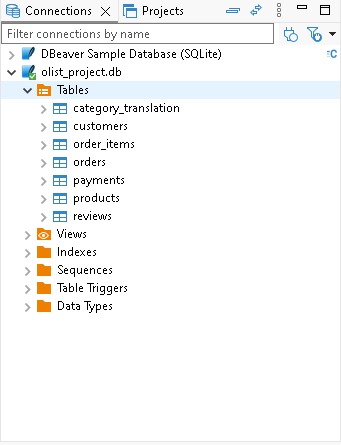
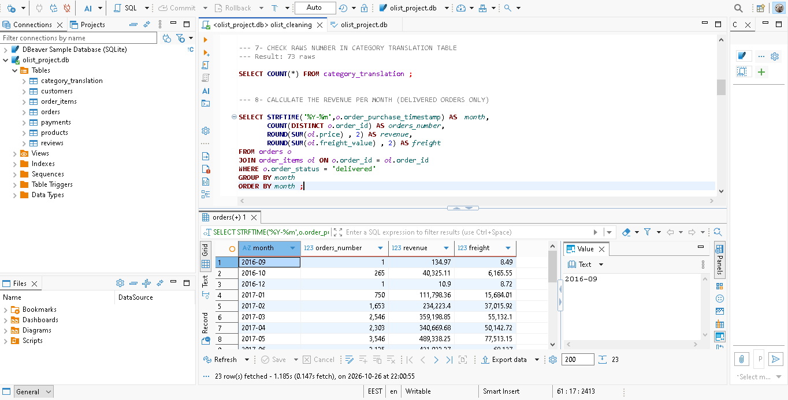
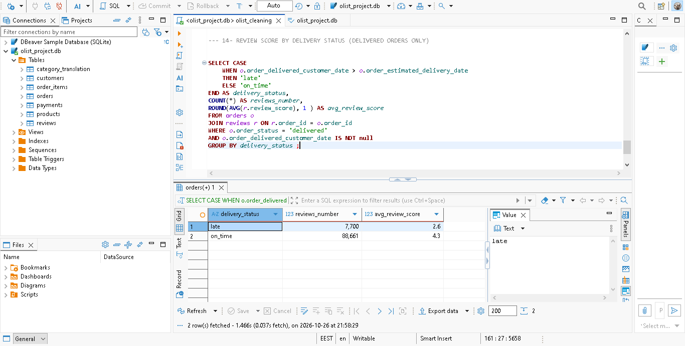
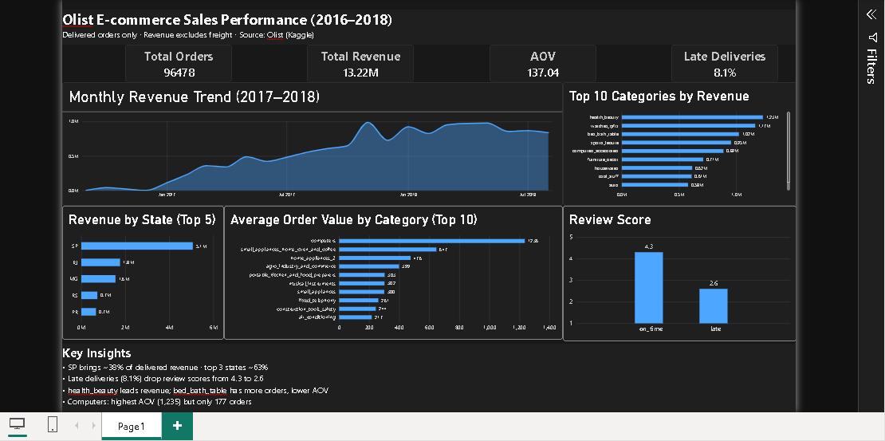

# Olist E-commerce Sales Performance (2016–2018)

**Business question:** Where does revenue come from on a Brazilian e-commerce marketplace, which categories and regions matter most, and does late delivery affect customer satisfaction?

## Project Structure

```
Project/
├── README.md
├── dashboard/
│   └── olist_dashboard.pbix
├── data/
│   └── exports/
│       ├── 08_monthly_revenue.csv
│       ├── 09_top_categories.csv
│       ├── 10_revenue_by_state.csv
│       ├── 11_aov_by_category.csv
│       ├── 12_delivery_status.csv
│       └── 14_review_by_delivery.csv
├── screenshots/
│   ├── dashboard.png
│   ├── sql_tables.png
│   ├── sql_monthly_revenue.png
│   └── sql_review_by_delivery.png
└── sql/
    └── olist_cleaning.sql
```

## Dataset

- **Source:** Olist public e-commerce dataset (Kaggle)
- **Period:** September 2016 to August 2018 (23 months with orders)
- **Scope:** Delivered orders only (96,478 orders)
- **Raw files used:** customers, orders, order items, payments, products, category translation, reviews
- **Not used:** geolocation, sellers

**Known limitations**
- September and December 2016 have only 1 order each, so trend analysis starts from January 2017.
- `customer_state` uses Brazilian 2-letter codes (SP, RJ, MG...).
- 610 products have no category. They are labelled "Unknown" and kept, not removed.
- Revenue is based on item `price` only. Freight is excluded and reported separately.
- Review scores show association with delivery delay, not proven causation.

## Tools

- **SQLite** (database)
- **DBeaver** (SQL editor and data import)
- **Power BI Desktop** (dashboard)

## Database Overview

The SQLite database contains 7 tables after import and cleanup:



## Data Cleaning Steps

Full script: `sql/olist_cleaning.sql`

| # | Step | Result |
|---|---|---|
| 1 | Import 6 CSVs into SQLite via DBeaver | 99,441 / 99,441 / 103,886 / 32,951 / 112,650 / 71 rows |
| 2 | Check translation table columns (encoding) | Columns clean |
| 3 | Find categories with no translation | 2 categories: `pc_gamer`, `portateis_cozinha_e_preparadores_de_alimentos` |
| 4 | Check empty category values in products | 610 products (NULL became empty string on import) |
| 5 | Add the 2 missing translations | 2 rows inserted (run once) |
| 6 | Verify translation table | 73 rows |
| 7 | Import reviews and check row count | 99,224 rows |
| 8 | Shorten table names | `reviews`, `orders`, etc. |

## Analysis

### 1. Monthly revenue trend
Revenue grew strongly through 2017, peaked in **November 2017 (about 987K)**, and stayed fairly stable through 2018 (roughly 830K to 970K per month).



### 2. Top categories by revenue
`health_beauty` leads with **1.23M** and 8,647 orders. `bed_bath_table` has the most orders (9,272) but ranks third in revenue, meaning a lower average order value.

### 3. Revenue by state
São Paulo (SP) alone brings about **38%** of delivered revenue (5.07M out of 13.22M). The top 3 states (SP, RJ, MG) together bring about **63%**.

### 4. Average order value by category
Computers have the highest AOV (**1,235.50**), but only 177 orders, so this figure is sensitive to a few large orders. Categories with high order volume and stable AOV, such as `musical_instruments` and `small_appliances` (about 300 each), are more reliable for comparison.

### 5. Delivery delay
| Status | Orders | Avg days vs estimate |
|---|---|---|
| On time | 88,652 | -13 days |
| Late | 7,826 (8.1%) | +9.6 days |

About 1 in 12 orders arrives late, and late orders are about 10 days late on average.

### 6. Delivery delay and review score
| Status | Reviews | Avg review score (out of 5) |
|---|---|---|
| On time | 88,661 | **4.3** |
| Late | 7,700 | **2.6** |



Late deliveries are associated with a **1.7-point drop** in average review score. This is an association; other factors such as product type or region may also play a role.

## Dashboard



The Power BI dashboard contains 4 KPI cards, a monthly revenue line chart, top 10 categories, revenue by state (top 5), average order value by category (top 10), a review score comparison, and key insights.

**KPIs**
- Total Orders: 96,478
- Total Revenue: 13.22M (excl. freight)
- AOV: 137.04
- Late Deliveries: 8.1%

## Key Insights

- SP brings about 38% of delivered revenue; the top 3 states bring about 63%.
- Late deliveries (8.1%) are associated with lower review scores: 4.3 on time vs 2.6 late.
- `health_beauty` leads revenue, while `bed_bath_table` has more orders at a lower average value.
- Computers have the highest AOV (1,235.50) but only 177 orders.

## Recommendations

- **Protect on-time delivery.** The gap between 4.3 and 2.6 in review score is large, so delivery reliability is likely a stronger lever than marketing for customer satisfaction. Start by investigating late orders in SP and the other high-volume states.
- **Focus marketing budget on high-revenue categories** such as `health_beauty` and `watches_gifts`.
- **Treat SP as the core market** and test growth campaigns in RJ and MG before expanding to smaller states.
- **Investigate high-AOV, low-volume categories** such as computers as a possible upsell opportunity, but validate with more data first.

## How to Reproduce

1. Import the 6 Olist CSVs into SQLite (DBeaver → Import Data → CSV), using short table names: `customers`, `orders`, `order_items`, `payments`, `products`, `category_translation`, and `reviews`.
2. Open `sql/olist_cleaning.sql` and run the steps in order. Steps that modify data (ALTER TABLE, INSERT) must run only once.
3. Export query results to `data/exports/` as CSV.
4. Open `dashboard/olist_dashboard.pbix` in Power BI Desktop and refresh the data sources from the CSVs.

The raw Olist CSV files and the SQLite database are not included in this repository because of their size. Download the dataset from Kaggle.
